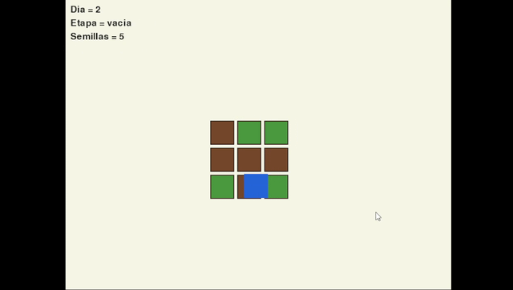
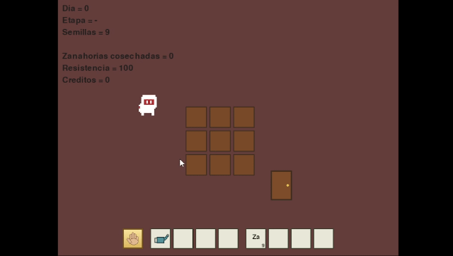
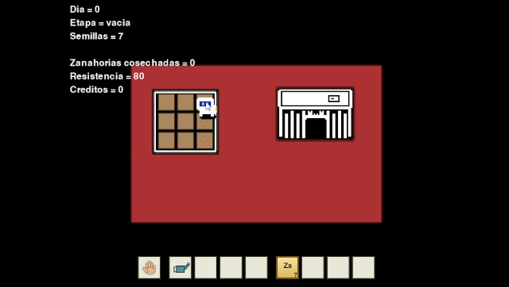
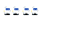
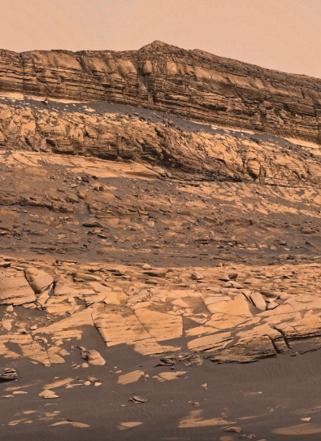
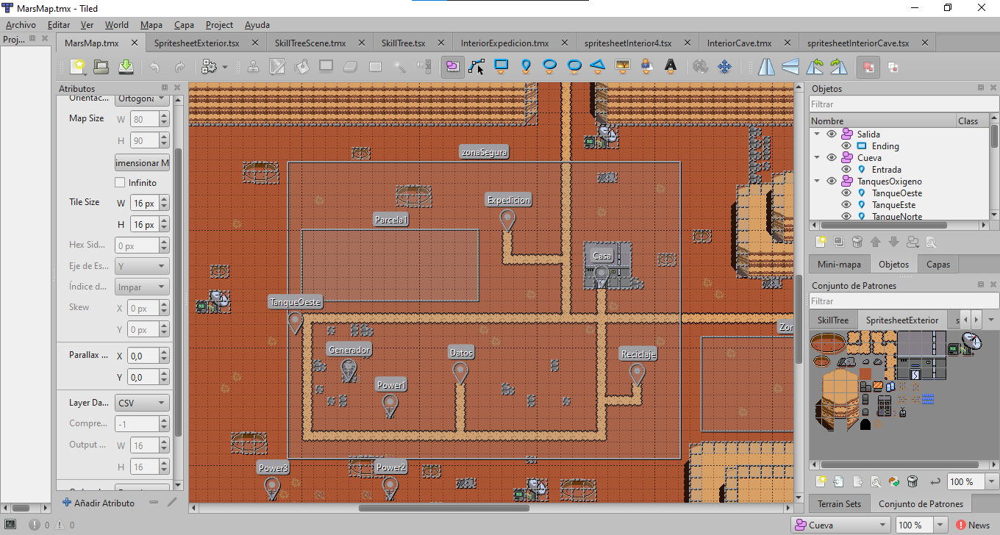
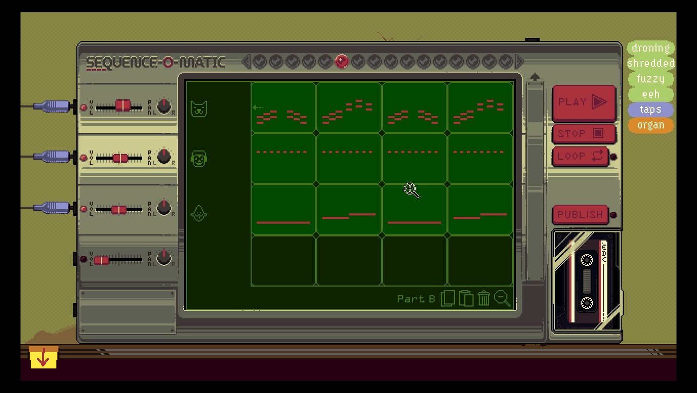

# Taller de diseño y programacion de videojuegos 2D - Facultad de Ingenieria

Videojuego 2D de agricultura y exploracion inspirado en Harvest Moon / Stardew valley. Desarrollado en Python utilizando Pygame. Incluye mecánicas de cultivo, gestión de recursos, exploración marciana y misiones para completar.

## Nombre del juego : MARS & ME
La historia del juego trata sobre el protagonista reconstruyendo la base Marciana para conseguir el dinero necesario para pagar la costosa operacion de su mascota llamada Mars que le quedan pocos meses de vida. 
El Titulo hace referencia a la pelicula Marley & me.

## Desarrollo y diseño
Primera etapa de desarrollo probando como plantar, regar y cosechar en una cuadricula que hacen de parcela de tierra.

  

Se empezó a concebir la idea de que el juego se desarrollase en un ambiente espacial. El primer diseño del protagonista, un inventario y cambio de escena.

  

La idea era hacer un juego con un diseño minimalista parecido a Minit (https://store.steampowered.com/app/609490/Minit/). Cada mapa iba a ocupar el espacio de pantalla y estarian conectados de manera que al desplazarte a los bordes cambiase de escena.

  

## Arte pixel art
Creado a mano pixel por pixel utilizando la herramienta Libresprite (https://libresprite.github.io/)

  
  

Se tomó como referencias fotos del paisaje de Marte para diseñar los sprites y la paleta de colores.

  
  

## Diseño de nivel
Para crear el mapa de la superficie de Marte se utilizó la herramienta Tiled (https://www.mapeditor.org/). Luego con una libreria llamada Pytmx se importó al juego y con la libreria Pyscroll se pudo implementar una camara libre que siguiera al jugador en todo momento.

  

## Música y sonido
Los efectos de sonido fueron grabados irl usando objetos cotidianos como monedas cayendo en un tarro, sacudir agua dentro de una botella etc. Luego se editó con la herramienta AudioMass (https://audiomass.co/) para quitar el ruido y normalizar los sonidos.

La música fue creada gracias a la herramienta/juego OFFBEAT Demo (https://store.steampowered.com/app/4468030/OFFBEAT/) que permite crear música con distintos tipos de instrumentos y exportarla de manera completamente libre para el proyecto que uno quiera.

  

## Recursos
Video trailer: https://youtu.be/ReHsvBhp1JQ?si=DDwrVrBsDfJrRKBd 

Build del juego: https://drive.google.com/drive/folders/1fzQTyvsZ-HQ3b9SyXfWw6beyGqmrA3D3?usp=drive_link

Descargar y extraer la carpeta ProjectTV2D y ejecutar ProjectTV2D.exe para iniciar el juego.
Las partidas se guardan en \AppData\Local\TVJ2D_2026_MarsAndMe

## Autor

Charliexover

© 2026 - Taller de diseño y programacion de videojuegos 2D - Facultad de Ingenieria
